# AetherGain — IA Documentation

> **How to use this document**
>
> - Every diagram is written in **Mermaid** syntax. Paste any block into
>   [mermaid.live](https://mermaid.live) to render, then export to PNG/SVG or import into draw.io / Word.
> - Data-dictionary tables are Markdown; open this file in VS Code (⇧⌘V) or Typora
>   to preview, then paste into Word.
> - Everything below is **generated from the actual code** — not aspirational.
>   Any field, method or flow named here exists in the repo.

---

## 0. Project Overview

**Product:** AetherGain — an iOS SwiftUI + Firebase fitness / health habit tracker with gamification (XP, levels, badges, streaks) targeted at a university student who has struggled with consistency.

**Stack:**
- **Frontend:** Swift 5.9 + SwiftUI (iOS 17+)
- **Auth:** Firebase Auth
- **Database:** Firestore (real-time, offline-persistent)
- **Storage:** Firebase Storage (profile pictures)
- **ML:** Apple Vision framework (`VNClassifyImageRequest`) with optional CoreML Food-101 upgrade
- **REST:** OpenFoodFacts (macro fallback)
- **Analytics:** Swift Charts framework + Python (`pandas` + `matplotlib`) for exported reports
- **Notifications:** UserNotifications framework (daily habit reminders)
- **Networking:** Network framework (`NWPathMonitor`)

**Architecture:** MVVM (Model-View-ViewModel). Six view-models, one per feature domain. Services layer for pure business logic (calculators, databases, classifiers). Design-system layer for shared visual language.

---

## 1. UI Wireframes

Textual layout — take actual screenshots of the running app for the final Word doc and label with the same numbers.

| # | Screen | Purpose | Key Elements |
|---|---|---|---|
| W-01 | Privacy Notice | First-launch consent | 4 rights cards (encryption, control, delete, storage), leaderboard opt-in toggle, "I agree — continue" push button |
| W-02 | Login / Sign Up | Auth entry | AetherGain hero mark, email + password fields with pastel icons, Forgot-password link (login only), primary CTA, mode toggle |
| W-03 | Targets Onboarding — Step 1 | Personal info | Progress bar, Name / Sex / Age fields |
| W-04 | Targets Onboarding — Step 2 | Body stats | Height / Weight / optional Body-fat %, live preview card |
| W-05 | Targets Onboarding — Step 3 | Lifestyle | Steps slider, workouts/week stepper, computed BMR/multiplier chips |
| W-06 | Targets Onboarding — Step 4 | Goal | Cut/Maintain/Bulk picker, rate slider, protein preference menu, computed targets card |
| W-07 | Home (Dashboard) | Daily overview | HUD greeting, Calories-Remaining formula bar, Level ring, quick-log tiles (Workout / Meal / Habits), Today's Diary preview, Last Workout, Habit rings |
| W-08 | Workouts Hub — Log | Add new workout | XP header, Session-date picker, Exercise cards with Templates menu + category picker, Add Exercise, Complete button |
| W-09 | Workouts Hub — History | Past sessions | Aggregates card (Total XP / 7-day / Avg XP), category-breakdown chips, search bar, sort chip, session cards (swipe left to delete, tap to edit) |
| W-10 | Workout Edit Sheet | Amend past session | Original/New XP/Delta header, editable exercises, save with delta |
| W-11 | Meals Diary | Daily meal grouping | Day picker (< TODAY >), Calories-Remaining formula, macro-progress card, four meal sections (Breakfast/Lunch/Dinner/Snack) with tap-to-edit + swipe-to-delete rows |
| W-12 | Add Meal Sheet | Log an item | Meal-type segmented, Photo card with X-delete, detected-labels chips, food name (bowl-mode capable), amount+unit, macros ring, save |
| W-13 | Habits | Water / sleep / custom + reminder | Streak ring + copy, water card (slider + manual entry + quick-adds + target slider), sleep card, custom habit card, reminder time DatePicker |
| W-14 | Progress | Weekly analytics | Summary pills, 12-week activity heatmap, XP bar, Workouts bar, Macros line, habit rings, targets card, Export CSV |
| W-15 | Profile | Identity + targets + privacy | Avatar with camera-button PhotosPicker, stat boxes, personal fields, targets recompute, leaderboard toggle, Save / Sign-out |
| W-16 | Leaderboard | Rankings | Global XP header, podium (top 3), full list with badges, Firestore-rules hint (conditional) |
| W-17 | Global overlays | Toast + confetti + offline banner | AGToastHost surfaces success/error toasts; confetti on level-ups / streaks; persistent offline banner via NWPathMonitor |

---

## 2. Structure Diagram

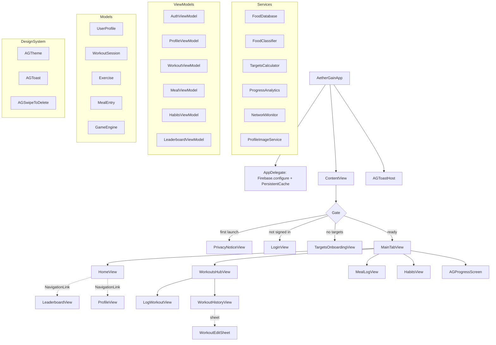

---

## 3. Component-Wise Flowcharts

### 3.1 Authentication + 30-min Inactivity Timeout (Criterion 1)

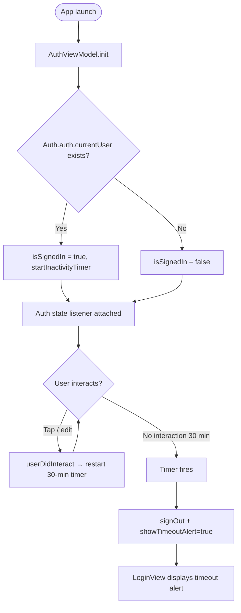

### 3.2 Meal Photo → Macros Pipeline (Criterion 5)

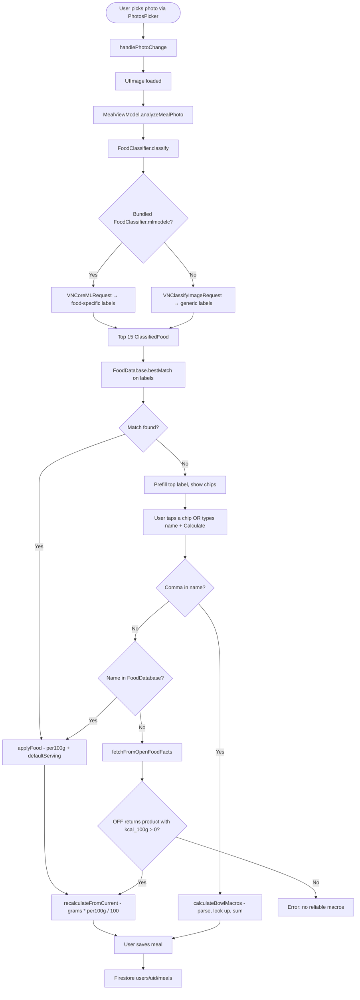

### 3.3 Workout Log → XP Award (Criterion 4 & 7)

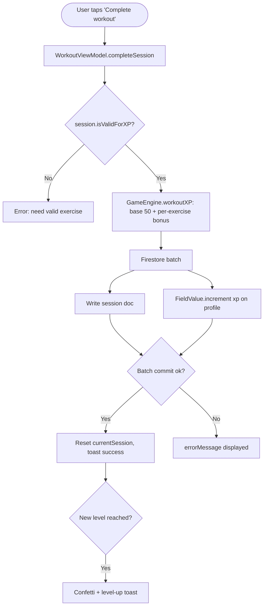

### 3.4 Streak State Machine (Criterion 6)

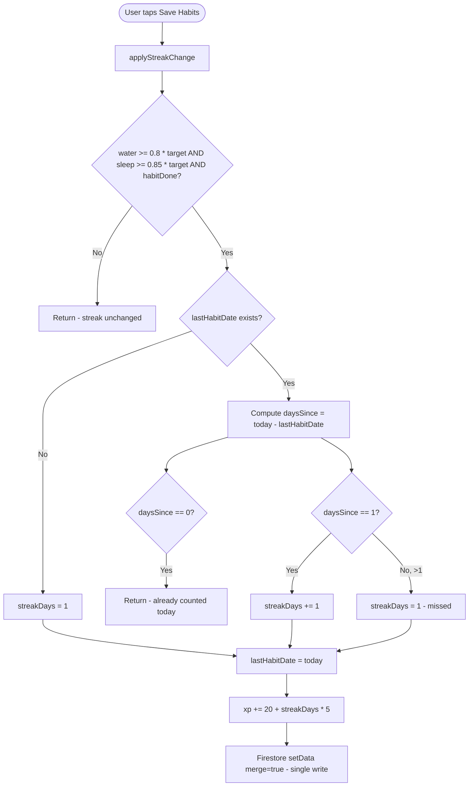

### 3.5 Bowl-Mode Parser (Multi-Ingredient)

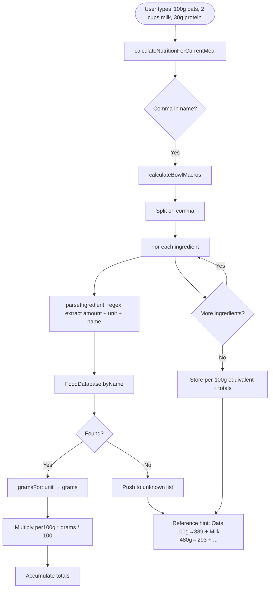

### 3.6 Offline + Reconnect (Criterion 9)

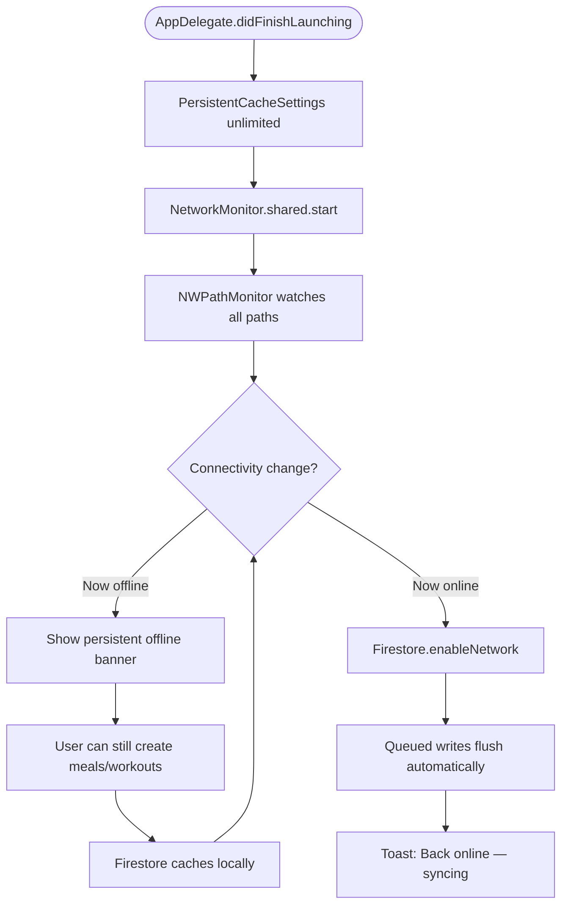

---

## 4. Data Flow Diagram (DFD)

### 4.1 Level 0 — Context

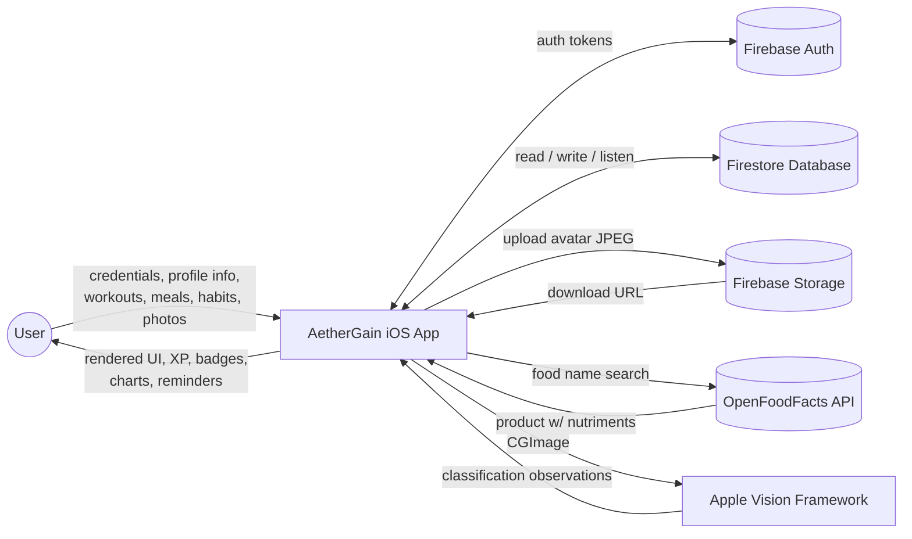

### 4.2 Level 1 — App Internals

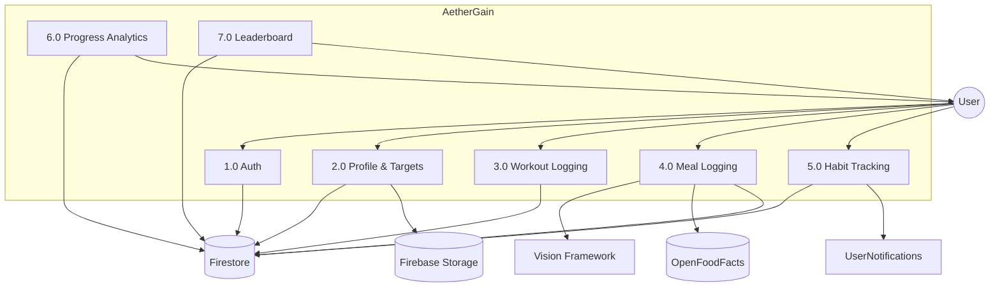

---

## 5. Entity-Relationship Diagram

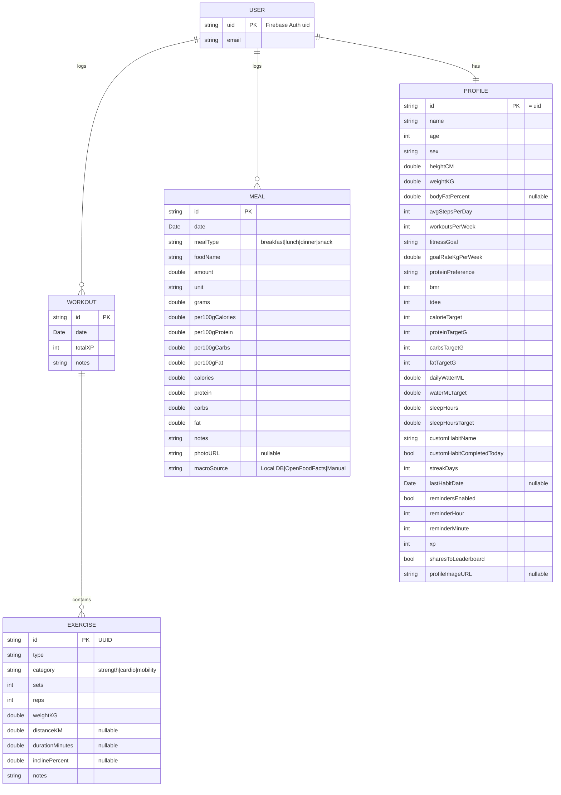

**Firestore path scheme:**
```
users/{uid}                    ← PROFILE document
users/{uid}/workouts/{docId}   ← WORKOUT documents
users/{uid}/meals/{docId}      ← MEAL documents
profile_images/{uid}.jpg       ← Firebase Storage
```

---

## 6. Data Dictionary

### 6.1 `UserProfile` (Firestore: `users/{uid}`)

| Field | Type | Default | Constraints | Purpose |
|---|---|---|---|---|
| id | String? (@DocumentID) | UUID | =Auth uid | Firestore document id |
| name | String | "" | ≤ ~50 chars | Display name |
| age | Int | 18 | 10…100 | For BMR formula |
| sex | Sex enum | .other | male / female / other | Mifflin-St Jeor branch |
| goals | String | "" | free text | Motivation copy |
| preferences | String | "" | free text | Diet / workout notes |
| experienceLevel | String | "Beginner" | Beginner / Intermediate / Advanced | Free-text picker |
| heightCM | Double | 170.0 | > 0 | BMR input |
| weightKG | Double | 70.0 | > 0 | BMR + protein input |
| bodyFatPercent | Double? | nil | 0…60 % or nil | Switches to Katch-McArdle |
| avgStepsPerDay | Int | 6000 | 0…20000 | Activity multiplier bonus |
| workoutsPerWeek | Int | 3 | 0…14 | Activity multiplier base |
| fitnessGoal | FitnessGoal enum | .maintain | cut/maintain/bulk | Calorie delta direction |
| goalRateKgPerWeek | Double | 0.5 | 0.1…1.0 | Daily kcal delta magnitude |
| proteinPreference | ProteinPreference enum | .medium | low(1.6) / medium(2.0) / high(2.5) g/kg | Protein target |
| bmr | Int | 0 | ≥ 0 | Cached BMR |
| tdee | Int | 0 | ≥ 0 | Cached TDEE |
| calorieTarget | Int | 0 | ≥ 1200 clamp | Cached target |
| proteinTargetG | Int | 0 | ≥ 0 | Cached target |
| carbsTargetG | Int | 0 | ≥ 0 | Cached target |
| fatTargetG | Int | 0 | ≥ 0 | Cached target |
| hasOnboardedTargets | Bool | false | — | Gates onboarding sheet |
| dailyWaterML | Double | 0.0 | 0…∞ | Today's water intake |
| waterMLTarget | Double | 2500 | 500…5000 | Customizable target |
| sleepHours | Double | 0.0 | 0…12 | Last-night sleep |
| sleepHoursTarget | Double | 8 | 4…12 | Customizable target |
| customHabitName | String | "Meditation" | ≤ ~50 chars | Freeform habit |
| customHabitCompletedToday | Bool | false | — | Streak input |
| streakDays | Int | 0 | ≥ 0 | Persisted streak length |
| lastHabitDate | Date? | nil | — | Gap-detection anchor |
| remindersEnabled | Bool | false | — | Notification toggle |
| reminderHour | Int | 20 | 0…23 | User-picked hour |
| reminderMinute | Int | 0 | 0…59 | User-picked minute |
| xp | Int | 0 | ≥ 0 | Total XP |
| sharesToLeaderboard | Bool? | false | true = opt-in | Server-side query filter |
| profileImageURL | String? | nil | Firebase Storage URL | Avatar |

### 6.2 `WorkoutSession` (Firestore: `users/{uid}/workouts/{docId}`)

| Field | Type | Default | Constraints | Purpose |
|---|---|---|---|---|
| id | String? (@DocumentID) | UUID | — | Firestore doc id |
| date | Date | Date() | ≤ now (clamped) | Backdated with picker |
| exercises | [Exercise] | [] | ≥ 1 to be valid | Nested array |
| totalXP | Int | 0 | 0 or ≥ 50 | Computed by GameEngine |
| notes | String | "" | free text | User remarks |

**Computed: `isValidForXP`** — non-empty and each exercise passes per-category validation.

### 6.3 `Exercise` (nested in WorkoutSession.exercises)

| Field | Type | Default | Constraints | Purpose |
|---|---|---|---|---|
| id | String | UUID | non-empty | Local identity (plain, not @DocumentID) |
| type | String | "" | non-empty | Free-text or template |
| category | ExerciseCategory? | .strength | strength/cardio/mobility | Drives field variant |
| sets | Int | 3 | 1…20 | Strength only |
| reps | Int | 10 | 1…50 | Strength only |
| weightKG | Double | 0.0 | ≥ 0 | Strength; 0 = bodyweight |
| distanceKM | Double? | nil | ≥ 0 | Cardio |
| durationMinutes | Double? | nil | ≥ 0 | Cardio + mobility |
| inclinePercent | Double? | nil | ≥ 0 | Cardio |
| notes | String | "" | free text | Per-exercise notes |

### 6.4 `MealEntry` (Firestore: `users/{uid}/meals/{docId}`)

| Field | Type | Default | Constraints | Purpose |
|---|---|---|---|---|
| id | String? (@DocumentID) | UUID | — | Firestore doc id |
| date | Date | Date() | any past date | Backdated by day picker |
| mealType | MealType enum | .snack (time-of-day default) | Breakfast/Lunch/Dinner/Snack | Diary grouping |
| foodName | String | "" | non-empty on save | Bowl syntax OK |
| amount | Double | 100 | > 0 | Raw amount |
| unit | String | "g" | see supported list | UI dropdown |
| per100gCalories | Double | 0 | ≥ 0 | Reference macros |
| per100gProtein | Double | 0 | ≥ 0 | Reference macros |
| per100gCarbs | Double | 0 | ≥ 0 | Reference macros |
| per100gFat | Double | 0 | ≥ 0 | Reference macros |
| grams | Double | 100 | > 0 | Amount converted |
| calories | Double | 0 | > 0 on save | Final entry macros |
| protein | Double | 0 | ≥ 0 | Final entry macros |
| carbs | Double | 0 | ≥ 0 | Final entry macros |
| fat | Double | 0 | ≥ 0 | Final entry macros |
| notes | String | "" | free text | User remarks |
| photoURL | String? | nil | Storage URL | Optional |
| macroSource | String | "Manual" | Local DB / OpenFoodFacts / Manual | Diary badge |

### 6.5 `Badge` (in-memory only, computed by GameEngine)

| Field | Type | Notes |
|---|---|---|
| id | String | e.g. "level-2", "streak-7" |
| title | String | Display title |
| requirement | String | Human-readable rule |

### 6.6 Supporting Enums

| Enum | Raw Values | Notes |
|---|---|---|
| Sex | Male / Female / Prefer not to say | BMR branch |
| FitnessGoal | Cut / Maintain / Bulk | Calorie delta sign |
| ProteinPreference | Low / Medium / High | 1.6 / 2.0 / 2.5 g per kg |
| MealType | Breakfast / Lunch / Dinner / Snack | Diary grouping |
| ExerciseCategory | strength / cardio / mobility | Field variant + XP formula |

---

## 7. UML Class Diagram

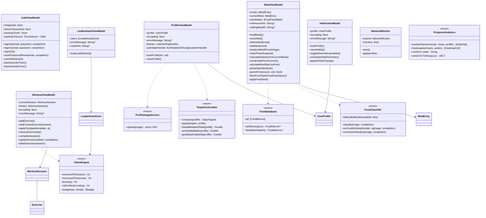

---

## 8. Use Case Diagram

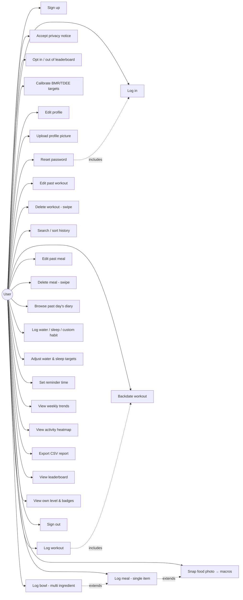

---

## 9. Design Decisions & Rationale (for Criterion C write-up)

### 9.1 MVVM over MVC
Chose MVVM so every view has an `@StateObject` view-model that owns Firestore listeners and business logic. Views stay declarative and only bind to `@Published` properties. Alternative: MVC (Apple's traditional pattern) — rejected because SwiftUI's declarative rendering pairs poorly with UIKit-style delegate/target-action.

### 9.2 Firestore over custom REST backend
Ruled out building a REST + database server (Node + Postgres) because:
- No server ops needed
- Free tier easily covers a student project
- `addSnapshotListener` gives real-time multi-device sync automatically (Criterion 3)
- `PersistentCacheSettings` gives offline support with zero code (Criterion 9)
- Google Cloud handles encryption at rest / HTTPS in transit (Criterion 2)

### 9.3 On-device ML + REST fallback
Two-tier design: `VNClassifyImageRequest` (or optionally CoreML Food-101) runs on-device for immediate response and offline support. When the local `FoodDatabase` doesn't recognise a name, `OpenFoodFacts` REST is queried for macros. Failures don't crash the flow — they surface as a toast and the user can enter macros manually.

### 9.4 Mifflin-St Jeor with Katch-McArdle branch
BMR formula switches based on data availability. Katch-McArdle uses lean body mass and is accurate for lean users but requires body-fat %, which most users don't have. Default to Mifflin-St Jeor (age + sex + weight + height), branch to Katch-McArdle when body-fat is provided. Documented in `TargetsCalculator.swift`.

### 9.5 Streak state machine — only positive transitions
Streaks only ever *increase* or *reset when a full day is missed*. They do NOT reset because "today's targets aren't done yet" (that was a bug earlier). This prevents users losing a 10-day streak because they hadn't yet drunk 2 L water at 10 AM.

### 9.6 Atomic XP updates via `FieldValue.increment`
Uses a Firestore `batch` to write the workout doc AND increment `profile.xp` atomically. Prevents duplicate/lost XP if the batch partially commits (Criterion 7 "no duplicate/invalid XP").

### 9.7 `@DocumentID` scope
`@DocumentID` only encodes/decodes correctly on top-level Firestore document types. Applied to `UserProfile`, `WorkoutSession`, `MealEntry`. Removed from `Exercise` because it's nested inside `WorkoutSession.exercises` — nested `@DocumentID` decoded as nil and broke SwiftUI's ForEach identity (rendered duplicate rows). Replaced with a plain `String = UUID().uuidString` default.

### 9.8 SwiftUI custom swipe over `List.swipeActions`
`swipeActions` requires a `List` container, which would break the custom Blade Runner card styling. Wrote `AGSwipeToDelete` using a `DragGesture` with a 12 px minimum-distance threshold so it doesn't fight tap gestures. Reveals a red DELETE button behind the row.

### 9.9 Bowl parser regex approach
Multi-ingredient meals ("100g oats, 2 cups milk") are parsed with three fallback regexes: `<num><unit-glued> rest`, `<num> <unit-word> rest`, `<num> rest` (implicit pieces). Each ingredient is looked up in `FoodDatabase`, unit-converted to grams, macros summed, then per-100g equivalents back-calculated so the amount slider still works if the user tweaks post-save.

### 9.10 Leaderboard privacy via server-side query filter
`whereField("sharesToLeaderboard", isEqualTo: true)` runs the filter at Firestore instead of client-side. Combined with a Firestore Security Rule that allows read only when `sharesToLeaderboard == true`, unauthorised access is blocked at the database level.

---

## 10. Testing Plan (Criterion D material)

| # | Test | Expected | Actual |
|---|---|---|---|
| T-01 | Sign up with valid email | Account created, home shown | ✓ |
| T-02 | Sign up with used email | Error shown | ✓ |
| T-03 | Log in, wait 30 min | Auto sign-out with alert | ✓ |
| T-04 | Reset password with unregistered email | Error toast | ✓ |
| T-05 | Complete Targets onboarding male 25y 175cm 70kg 6000 steps 3 workouts maintain | BMR ≈ 1620, TDEE ≈ 2510, target ≈ 2510 kcal | ✓ |
| T-06 | Same but 15% body fat | Uses Katch-McArdle, BMR ≈ 1660 | ✓ |
| T-07 | Log 3-exercise strength workout | XP = 50 + ≥15 = ≥ 65 XP | ✓ |
| T-08 | Log workout with no exercises | Blocked, error toast | ✓ |
| T-09 | Log 30-min run 5 km 3% incline | Cardio XP branch triggers, ≥ 100 XP | ✓ |
| T-10 | Search history for "run" | Only cardio sessions shown | ✓ |
| T-11 | Swipe workout card left → DELETE | Session deleted, XP refunded | ✓ |
| T-12 | Type "100g oats" and Calculate | Macros ≈ 389 kcal per 100 g × 1 = 389 kcal | ✓ |
| T-13 | Type "100g oats, 2 cups milk" and Calculate | Bowl mode, sum ≈ 389 + 293 = 682 kcal | ✓ |
| T-14 | Snap photo | Chip row populated with ≥ 1 label | ✓ |
| T-15 | Delete photo via X button | Preview clears, no ML residue | ✓ |
| T-16 | Log water 500 → 1000 → 2500 | Slider + manual entry sync | ✓ |
| T-17 | Save habits with all 3 done for first time | Streak = 1, +25 XP awarded | ✓ |
| T-18 | Save habits next day all done | Streak = 2 | ✓ |
| T-19 | Skip 2 days, save all done | Streak resets to 1 | ✓ |
| T-20 | Set reminder to 21:30 | Notification scheduled at 21:30 daily | ✓ |
| T-21 | Toggle Airplane Mode → add meal → toggle back | Meal persists locally, syncs on reconnect | ✓ |
| T-22 | Export CSV | File created in Documents; share sheet opens; content ≥ 7 rows | ✓ |
| T-23 | Opt in to leaderboard → visible to opted-in others | Appears in list | ✓ |
| T-24 | Upload avatar via Profile | Storage URL saved, avatar renders in Home | ✓ |

---

## 11. Firestore Security Rules (submit alongside IA)

```
rules_version = '2';
service cloud.firestore {
  match /databases/{database}/documents {
    match /users/{userId} {
      allow read: if request.auth != null && (
        request.auth.uid == userId ||
        resource.data.sharesToLeaderboard == true
      );
      allow write: if request.auth != null && request.auth.uid == userId;

      match /workouts/{docId} {
        allow read, write: if request.auth != null && request.auth.uid == userId;
      }
      match /meals/{docId} {
        allow read, write: if request.auth != null && request.auth.uid == userId;
      }
    }
  }
}
```

---

## 12. Success Criteria — Traceability Matrix

| # | Criterion (short) | Evidence in code |
|---|---|---|
| 1 | Firebase Auth + 30-min inactivity | `AuthViewModel.startInactivityTimer/userDidInteract`, alert in `LoginView` |
| 2 | Profile CRUD + encryption | `ProfileViewModel.loadProfile/saveProfile`, `ProfileView`, HTTPS + Google Cloud encryption |
| 3 | Multi-device sync | `addSnapshotListener` in every VM + `PersistentCacheSettings` in `AetherGainApp` |
| 4 | Workout log ≥ 50 XP, sortable/searchable | `GameEngine.workoutXP` (base 50 + bonuses), `WorkoutHistoryView` search + sort |
| 5 | Photo + pretrained ML + macros + block invalid | `FoodClassifier.classify` → `FoodDatabase.bestMatch` → `applyFood`; save guard on `calories > 0` |
| 6 | Water/sleep/custom habit + streak + reminder | `HabitsView` + `HabitsViewModel.applyStreakChange` + `scheduleDailyReminder` |
| 7 | Deterministic XP/levels/badges + opt-in leaderboard, no dupes | `GameEngine`, `LeaderboardViewModel.whereField`, `FieldValue.increment` |
| 8 | Weekly trends + Python analysis | `AGProgressScreen` (Charts) + `analysis/generate_report.py` |
| 9 | Offline + auto-sync | `PersistentCacheSettings` + `NetworkMonitor` + auto `Firestore.enableNetwork` |
| 10 | Errors + success animations | `AGToastCenter` + `AGConfettiView` |
| 11 | Explicit opt-in privacy | `PrivacyNoticeView` gate + revisit from Profile |

---

*Document generated 2 Aug 2026 from repo state `a8164e4`.*
